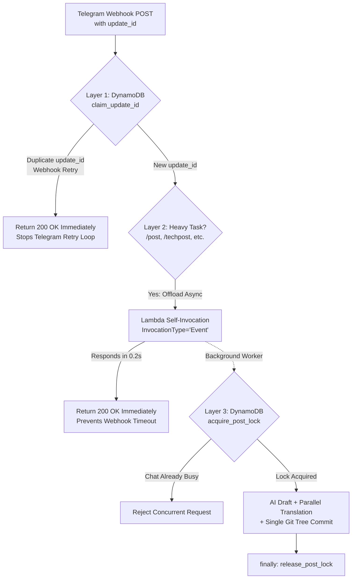

# Fixing Duplicate Telegram Webhook Posts: DynamoDB Idempotency, Async Self-Invocation, and Git Tree Atomic Commits

::: tip 1-Line Summary
An engineering breakdown of how we eliminated duplicate blog post generation caused by AI translation exceeding Telegram's 30-second webhook timeout—using **DynamoDB atomic `update_id` idempotency, Lambda asynchronous self-invocation (`InvocationType='Event'`), and single-commit Git Tree API updates**.
:::

---

## 1. Incident Overview & Emergency Mitigation

While publishing a technical article from chat history via the `/techpost` command on our serverless Telegram bot, an unexpected retry loop occurred:

1. The Telegram chat continuously reported progress messages (`⏳ Generating post...`, `🌐 Translating to EN and JA...`).
2. Before the first job completed, **an identical job started from scratch** in parallel.
3. Within minutes, **five nearly identical articles (15 markdown files across KO/EN/JA)** with slightly different AI-generated titles were committed to the blog repository.
4. As an immediate circuit breaker, we set the AWS Lambda function's **Reserved Concurrency to `0`** to halt execution and began root-cause analysis.

---

## 2. Root Cause Analysis

### Cause 1: Telegram Webhook Timeout & Retry Behavior
Even with English and Japanese translations running in parallel via `asyncio.gather()`, generating a long-form technical post exceeded 30 seconds:

* **Title generation**: ~4–5s
* **Korean markdown draft generation**: ~20–30s
* **Parallel EN & JA translation**: ~15–25s
* **GitHub REST API commits**: ~4–5s

When total execution time reached **45–60 seconds**, Telegram's webhook server—waiting synchronously on the Lambda Function URL for an `HTTP 200 OK`—**timed out around the 30-second mark and re-sent the exact same webhook payload (`update_id`)**.

Because `/techpost` was invoked without an explicit title argument, each retried Lambda invocation asked Gemini to generate a title from scratch, producing five distinct filenames for the same article.

### Cause 2: Multi-Commit API Calls & `tech/index.md` Dead Links on Deletion
Previously, `GithubUploader` committed the KO/EN/JA markdown files and the three `tech/index.md` files via separate `create_file()` / `delete_file()` REST calls:
* Publishing or deleting a single post triggered **up to 6 separate commits**, running the GitHub Actions deployment workflow 6 times in a row and rapidly burning through the daily 200-request Google Indexing API quota.
* Furthermore, `/delete` removed the markdown files without stripping the corresponding table row in `tech/index.md`, causing VitePress builds to fail with a `Dead Link` error.

---

## 3. Solution Part 1: 3-Layer Defense Against Duplicate Execution

To guarantee exactly-once execution in a serverless webhook environment, we implemented a three-layer defense combining **Idempotency, Async Offloading, and Distributed Locking**.



### Layer 1: Atomic `update_id` Idempotency via DynamoDB Conditional Writes
Every Telegram webhook retry carries the **exact same `update_id`** as the original delivery. At the very beginning of the webhook handler, we atomically claim the `update_id` in DynamoDB using `ConditionExpression="attribute_not_exists(PK)"`:

```python
# dynamo_manager.py - Atomic update_id claim
def claim_update_id(self, update_id: int) -> bool:
    uid_str = str(update_id)
    now = int(time.time())
    try:
        self.table.put_item(
            Item={
                "PK": "PROCESSED_UPDATE",
                "SK": uid_str,
                "created_at": now,
                "ttl": now + 86400  # Auto-expire after 24h
            },
            ConditionExpression="attribute_not_exists(PK)"
        )
        return True
    except ClientError as ce:
        if ce.response["Error"]["Code"] == "ConditionalCheckFailedException":
            # Already in-flight or processed -> block retry
            return False
        return True
```

Even if a retry arrives while the first invocation is still running, the second invocation hits `ConditionalCheckFailedException` in <10ms and **immediately returns `200 OK`**, clearing Telegram's retry queue on the spot.

### Layer 2: Asynchronous Lambda Self-Invocation (`InvocationType='Event'`)
To prevent the initial request from ever hitting Telegram's timeout in the first place, long-running commands (`/post`, `/techpost`, `/draft`) asynchronously invoke the same Lambda function as a background worker and **return `200 OK` to Telegram within 0.2 seconds**:

```python
# lambda_function.py - Offload to async background worker
def invoke_async_worker(update_data: dict, context) -> bool:
    fn_name = getattr(context, "invoked_function_arn", None) or getattr(context, "function_name", None)
    lambda_client = boto3.client("lambda", region_name=AWS_REGION)
    response = lambda_client.invoke(
        FunctionName=fn_name,
        InvocationType="Event",  # Async invocation (returns 202 immediately)
        Payload=json.dumps({
            "is_async_worker": True,
            "update_data": update_data
        }).encode("utf-8")
    )
    return response.get("StatusCode") in (200, 202)
```

We added `"lambda:InvokeFunction"` to the Lambda execution role's IAM policy, while preserving a seamless fallback to inline execution (protected by Layers 1 and 3) if the permission is absent.

### Layer 3: Per-Chat Distributed Lock (`POST_LOCK`) & In-Place Progress Updates
To prevent accidental double-commands from the user, `acquire_post_lock()` enforces a 120-second TTL mutex per `chat_id` and releases it in a `finally` block. Additionally, instead of sending 4 separate progress messages, the bot now sends **a single status message and updates it in-place (`edit_message_text`: `1/3 ➔ 2/3 ➔ 3/3 ➔ ✅ Done`)**.

---

## 4. Solution Part 2: Git Tree Atomic Commits & 1-Click Inline Deletion

### 1) Single Atomic Commits via GitHub Git Tree API
Instead of issuing 6 separate REST API commits per post, we now manipulate the Git tree directly so that **creating or deleting 3 language files, updating all 3 `tech/index.md` tables, and cleaning up orphaned images happen in a single commit**:

* Create/Update file: `InputGitTreeElement(path=path, mode="100644", type="blob", content=content)`
* Delete file: `InputGitTreeElement(path=path, mode="100644", type="blob", sha=None)`

```python
# github_uploader.py - Batch all updates and deletes into 1 atomic commit
ref = self.repo.get_git_ref(f"heads/{self.branch}")
base_commit = self.repo.get_git_commit(ref.object.sha)

tree_elements = []
for path, content in updates.items():
    tree_elements.append(InputGitTreeElement(path=path, mode="100644", type="blob", content=content))
for path in deletes:
    tree_elements.append(InputGitTreeElement(path=path, mode="100644", type="blob", sha=None))

new_tree = self.repo.create_git_tree(tree_elements, base_tree=base_commit.tree)
new_commit = self.repo.create_git_commit(commit_message, new_tree, [base_commit])
ref.edit(new_commit.sha)
```

### 2) Interactive Inline-Button Deletion (Bypassing Telegram's 64-Byte Callback Limit)
Typing `/delete` without arguments now displays an interactive paginated inline keyboard of recent posts.
* Because Telegram restricts `callback_data` to **64 bytes** (too small for Korean filenames), we generate a 10-character MD5 token (`del_sel_8f3a1b2c9d`) backed by DynamoDB with a stateless hash-matching fallback against the repository file list.
* Every newly published post message also includes instant `[🗑️ Delete Post]` and `[🙈 Unpublish (Draft)]` buttons for 1-second rollback.

---

## 5. Key Takeaways

1. **Flush Pending Webhook Queues Before Re-Enabling Concurrency**: Before restoring Lambda concurrency from `0`, always call `setWebhook?url=...&drop_pending_updates=true` to clear queued retries on Telegram's servers.
2. **Never Block Webhooks on LLM Pipelines**: Pairing **Asynchronous Self-Invocation (`200 OK` in 0.2s)** with **DynamoDB Conditional Write Idempotency (`update_id`)** is the gold standard for zero-cost serverless bots.
3. **Batch Static-Site Repo Updates**: Using the Git Tree API reduces CI/CD build runs and Google Indexing API quota consumption by over 80%.

---
*Posted: 2026-10-21 14:52:00*
