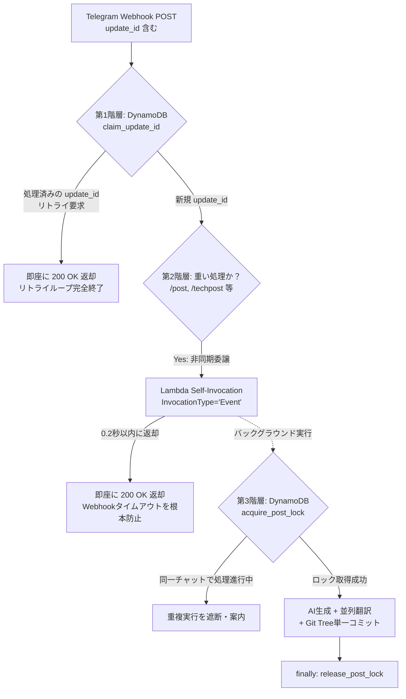

# Telegram Webhook重複投稿バグの解決記：DynamoDBべき等性制御、非同期自己呼び出し、Git Tree単一コミット

::: tip 1行要約
AIブログ草稿生成および多言語翻訳の処理時間（45秒以上）がTelegramのWebhookタイムアウト（30秒）を超過し、同一記事が5件連続で重複投稿された問題を、**DynamoDB `update_id` アトミック先占（Idempotency）＋ Lambda非同期自己呼び出し（`InvocationType='Event'`）＋ Git Tree API単一コミット**で完全に解決したエンジニアリング記録です。
:::

---

## 1. 障害現象と緊急措置（Incident Overview）

Telegramボットで `/techpost` コマンドを実行し、対話履歴を技術ブログ記事として自動発行していた際に以下の異常現象が発生した。

1. Telegramチャット画面に `⏳ 本文を生成中です...`、`🌐 英語・日本語への自動翻訳を同時実行中です...` という進行メッセージが繰り返し送信された。
2. 最初の投稿処理がまだ完了していないにもかかわらず、**同じ作業に対する新しい進行メッセージが最初から再スタート**した。
3. 結果として約1分間隔で同じテーマの記事が、AIが付けた微妙に異なるタイトルで**計5件（3言語合計15ファイル）重複アップロード**された。
4. 追加の重複発行を即座に遮断するため、AWS Lambdaコンソールで**予約済み同時実行数（Reserved Concurrency）を `0` に設定**して関数を一時停止し、原因分析に着手した。

---

## 2. 根本原因の分析（Root Cause Analysis）

### 原因 1. Telegram Webhookタイムアウトと自動リトライ機構
以前、日英翻訳を `asyncio.gather()` で並列化して処理時間を短縮していたものの、長文の技術記事を生成する際にはパイプライン全体の所要時間が30秒を超えていた。

* **タイトル自動生成**: 約4〜5秒
* **韓国語Markdown本文生成**: 約20〜30秒
* **英語（EN）・日本語（JA）並列翻訳**: 約15〜25秒
* **GitHub REST APIファイルコミット**: 約4〜5秒

合計所要時間が **45〜60秒** に達すると、同期方式でLambda Function URLを呼び出していたTelegram Webhookサーバーは `HTTP 200 OK` 応答を待ちきれず、**約30秒経過時点でタイムアウトと判定して同一のWebhookイベント（`update_id`）を再送信**した。

タイトル引数を省略して `/techpost` のみを実行していたため、リトライで起動した2つ目・3つ目のLambdaコンテナがそれぞれAIに新しいタイトルを生成させ、ファイル名が少しずつ異なる重複記事が次々とコミットされてしまった。

### 原因 2. 個別ファイルのREST API呼び出しによる多重コミットと `tech/index.md` のリンク切れ
従来の `GithubUploader` は、韓・英・日のMarkdownファイルと3言語の `tech/index.md` インデックスファイルをそれぞれ個別に `create_file()` / `delete_file()` で呼び出していた。
* 記事を1件投稿・削除するたびに**最大6回の個別コミット**が発生し、GitHub Actionsのビルドが6回連続でトリガーされ、Google Indexing APIの日次無料クォータ（200件）を急速に消費していた。
* さらに記事削除（`/delete`）時にはMarkdownファイルのみを削除し、`tech/index.md` のテーブル行を削除していなかったため、VitePressビルド時に `Dead Link` エラーでデプロイが失敗する構造的欠陥があった。

---

## 3. 解決アーキテクチャ 1：重複実行を防ぐ3重防御システム

Telegram Webhookのリトライ特性とサーバーレス環境を考慮し、**べき等性（Idempotency）・非同期分離（Async Offloading）・分散ロック（Mutex Lock）**の3階層防御構造を設計した。



### 第1階層：DynamoDB条件付き書き込み（`ConditionExpression`）による `update_id` べき等性保証
Telegramが再送信するWebhookペイロードは、初回リクエストと**完全に同一の `update_id`** を持つ。Webhook受信直後にDynamoDBへ `attribute_not_exists(PK)` 条件付きで `update_id` をアトミックに記録する。

```python
# dynamo_manager.py - Webhook update_id のアトミック先占
def claim_update_id(self, update_id: int) -> bool:
    uid_str = str(update_id)
    now = int(time.time())
    try:
        self.table.put_item(
            Item={
                "PK": "PROCESSED_UPDATE",
                "SK": uid_str,
                "created_at": now,
                "ttl": now + 86400  # 24時間後に自動削除
            },
            ConditionExpression="attribute_not_exists(PK)"
        )
        return True
    except ClientError as ce:
        if ce.response["Error"]["Code"] == "ConditionalCheckFailedException":
            # 既に処理中または処理完了した update_id -> リトライを即座に遮断
            return False
        return True
```

万が一最初の処理が長引いてTelegramがリトライを送ってきても、2回目のリクエストは `claim_update_id()` で `False` を受け取り、**0.01秒で `200 OK` を返却**する。これによりTelegram側のリトライキューはその場で解消される。

### 第2階層：Lambda非同期自己呼び出し（`InvocationType='Event'`）
初回リクエスト自体が30秒タイムアウトに引っかからないよう、`/post`、`/techpost`、`/draft` などの重い処理はLambdaが自分自身を非同期イベントモードで呼び出し、**Webhook接続には0.2秒以内に即座に `200 OK` を返す**。

```python
# lambda_function.py - 非同期バックグラウンドワーカーへの委譲
def invoke_async_worker(update_data: dict, context) -> bool:
    fn_name = getattr(context, "invoked_function_arn", None) or getattr(context, "function_name", None)
    lambda_client = boto3.client("lambda", region_name=AWS_REGION)
    response = lambda_client.invoke(
        FunctionName=fn_name,
        InvocationType="Event",  # 非同期呼び出し（即座に 202 返却）
        Payload=json.dumps({
            "is_async_worker": True,
            "update_data": update_data
        }).encode("utf-8")
    )
    return response.get("StatusCode") in (200, 202)
```

Lambda実行ロール（IAM Role）のポリシーに `"lambda:InvokeFunction"` 権限を追加し、権限が未設定の環境でも自動的に第1・第3階層保護下のインライン実行へフォールバックするよう実装した。

### 第3階層：チャット単位の分散ロック（`POST_LOCK`）と単一ステータスメッセージ更新
ユーザーの誤操作による連続入力も防ぐため、`ConditionExpression="attribute_not_exists(PK) OR #ttl < :now"` ベースの分散ロック（`acquire_post_lock`）を導入し、`finally` ブロックで確実に解放するようにした。また、進行状況を新規メッセージで連投せず、**1つのステータスメッセージを `edit_message_text` でインプレース更新（`1/3 ➔ 2/3 ➔ 3/3 ➔ ✅ 完了`）**するよう改善した。

---

## 4. 解決アーキテクチャ 2：Git Tree API単一コミット＆ワンクリック削除UI

### 1) GitHub Git Tree APIによるアトミックコミット（Single Atomic Commit）
記事の発行や削除時にファイルごとにコミットを作成する代わりに、GitのTreeオブジェクトを直接操作して**3言語のMarkdown＋3言語の `tech/index.md` 更新＋本文内の添付画像整理をたった1回のコミット**にまとめた。

* ファイル作成・更新：`InputGitTreeElement(path=path, mode="100644", type="blob", content=content)`
* ファイル削除：`InputGitTreeElement(path=path, mode="100644", type="blob", sha=None)`（`sha=None` でツリーから該当パスを削除）

```python
# github_uploader.py - 複数ファイルの更新・削除を1回のコミットで反映
ref = self.repo.get_git_ref(f"heads/{self.branch}")
base_commit = self.repo.get_git_commit(ref.object.sha)

tree_elements = []
for path, content in updates.items():
    tree_elements.append(InputGitTreeElement(path=path, mode="100644", type="blob", content=content))
for path in deletes:
    tree_elements.append(InputGitTreeElement(path=path, mode="100644", type="blob", sha=None))

new_tree = self.repo.create_git_tree(tree_elements, base_tree=base_commit.tree)
new_commit = self.repo.create_git_commit(commit_message, new_tree, [base_commit])
ref.edit(new_commit.sha)
```

### 2) インラインボタンによるワンクリック削除UI（64バイト制限の回避）
キーワードなしで `/delete` と入力するだけで、最新記事リストがインラインボタンとして表示されるようにした。
* Telegramの `callback_data` は**最大64バイト**に制限されているため、長い韓国語ファイル名をそのまま入れることはできない。
* そこで `{folder}/{filename}` のMD5ハッシュ先頭10文字（`del_sel_8f3a1b2c9d`）をトークンとして使い、DynamoDBへのマッピングとリポジトリファイル一覧からのハッシュ照合フォールバックを組み合わせることで、TTL満了後も**100%ステートレスに復元可能**にした。
* 投稿完了メッセージの下部にも `[🗑️ 投稿した記事を削除]` / `[🙈 非公開に切り替え]` ボタンを自動付与し、1秒でロールバックできるようにした。

---

## 5. まとめと運用チェックリスト

1. **Webhook待機キューの初期化**: 同時実行数制限（`0`）で停止させたLambdaを再稼働する前には、必ず `setWebhook?url=...&drop_pending_updates=true` を呼び出してTelegramサーバー上に溜まった過去のリトライキューを空にする必要がある。
2. **WebhookとLLMの結合時は非同期応答が必須**: LLM生成のように数十秒かかる処理をWebhookに直結する場合は、**即時 `200 OK` 返却（Self-Invocation）＋ イベントIDべき等性検証（DynamoDB Conditional Write）**の組み合わせが最も確実かつコスト0円の標準パターンである。
3. **GitHub Actionsトリガーの最適化**: 静的サイトジェネレーター（VitePress）へAPI経由で多言語ファイルをプッシュする際は、`Git Tree API` で単一コミット化することでビルド時間とGoogle Indexing APIクォータを80%以上節約できる。

---
*投稿日時: 2026-10-21 14:52:00*
