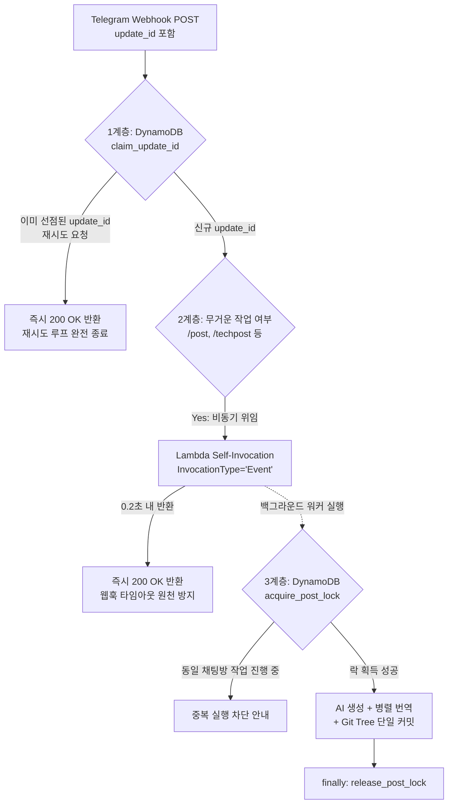

# 텔레그램 웹훅 중복 포스팅 버그 해결기: DynamoDB 멱등성, 비동기 자기 호출, Git Tree 단일 커밋

::: tip 1줄 요약
AI 블로그 초안 생성 및 다국어 번역 시간(45초+)이 텔레그램 웹훅 타임아웃(30초)을 초과해 동일 게시물이 5개씩 중복 발행되던 문제를 **DynamoDB `update_id` 원자적 선점(Idempotency) + Lambda 비동기 자기 호출(`InvocationType='Event'`) + Git Tree API 단일 커밋**으로 완벽히 해결한 엔지니어링 기록입니다.
:::

---

## 1. 장애 현상 및 긴급 조치 (Incident Overview)

텔레그램 봇에서 `/techpost` 명령어로 대화 기록을 기술 블로그 아티클로 발행하던 중 다음과 같은 이상 현상이 발생했다.

1. 텔레그램 채팅창에 `⏳ 본문을 생성 중입니다...`, `🌐 영문 및 일문으로 자동 번역을 동시에 수행 중입니다...` 진행 메시지가 계속 올라왔다.
2. 첫 번째 포스팅 작업이 아직 끝나지 않았는데도 **동일한 작업에 대한 새로운 진행 메시지가 다시 시작**되었다.
3. 결과적으로 약 1분 간격으로 똑같은 주제의 게시글이 제목만 미세하게 바뀐 채 **총 5개(3개 국어 합산 15개 파일)가 블로그에 중복 업로드**되었다.
4. 추가 중복 발행을 즉시 차단하기 위해 AWS Lambda 콘솔에서 **예약된 동시성(Reserved Concurrency)을 `0`으로 설정**하여 함수를 일시 정지시킨 뒤 원인 분석에 돌입했다.

---

## 2. 근본 원인 분석 (Root Cause Analysis)

### 원인 1. 텔레그램 웹훅 타임아웃(Webhook Timeout)과 재시도 메커니즘
기존에 영/일 번역을 `asyncio.gather()`로 병렬화하여 시간을 단축했음에도, 긴 기술 문서를 작성할 때는 전체 파이프라인 소요 시간이 30초를 넘겼다.

* **제목 자동 생성**: 약 4~5초
* **한국어 마크다운 본문 생성**: 약 20~30초
* **영문(EN) · 일문(JA) 병렬 번역**: 약 15~25초
* **GitHub REST API 파일 커밋**: 약 4~5초

총 소요 시간이 **45~60초**에 달하자, 동기식(RequestResponse)으로 Lambda Function URL을 호출한 텔레그램 웹훅 서버는 `HTTP 200 OK` 응답을 기다리다 **약 30초 시점에 타임아웃으로 판정**하고 동일한 웹훅 이벤트(`update_id`)를 재전송했다.

제목 인자 없이 `/techpost`만 호출한 상태였기 때문에, 재시도된 두 번째·세 번째 Lambda 컨테이너는 각각 AI에게 새 제목을 생성하게 했고, 결국 파일명이 조금씩 다른 중복 게시글이 연달아 커밋되었다.

### 원인 2. 개별 파일 REST API 호출로 인한 다중 커밋과 `tech/index.md` Dead Link
기존 `GithubUploader`는 한국어·영어·일본어 마크다운 파일과 3개 국어 `tech/index.md` 색인 파일을 각각 `repo.create_file()` / `repo.delete_file()`로 개별 호출했다.
* 글 1개를 올리거나 지울 때마다 **최대 6번의 개별 커밋**이 발생해 GitHub Actions 배포 파이프라인이 6회 연속 트리거되고 Google Indexing API 일일 무료 쿼터(200건)가 빠르게 소진되었다.
* 특히 게시글 삭제(`/delete`) 시 마크다운 파일만 삭제하고 `tech/index.md` 표에 걸린 링크 행을 제거하지 않아, VitePress 빌드 과정에서 `Dead Link` 에러로 배포가 실패하는 구조적 결함이 있었다.

---

## 3. 해결 아키텍처 1: 중복 실행 방지를 위한 3중 방어 체계

텔레그램 웹훅의 재시도 특성과 서버리스 환경을 고려하여 **멱등성(Idempotency) · 비동기 분리(Async Offloading) · 분산 락(Mutex Lock)** 3계층 방어 구조를 설계했다.



### 방어 1계층: DynamoDB 조건부 쓰기(`ConditionExpression`)를 통한 `update_id` 멱등성 보장
텔레그램이 재전송하는 웹훅 페이로드는 최초 요청과 **완전히 동일한 `update_id`**를 가진다. 웹훅 진입 즉시 DynamoDB에 `attribute_not_exists(PK)` 조건으로 `update_id`를 원자적으로 기록한다.

```python
# dynamo_manager.py - 웹훅 update_id 원자적 선점
def claim_update_id(self, update_id: int) -> bool:
    uid_str = str(update_id)
    now = int(time.time())
    try:
        self.table.put_item(
            Item={
                "PK": "PROCESSED_UPDATE",
                "SK": uid_str,
                "created_at": now,
                "ttl": now + 86400  # 24시간 후 자동 만료
            },
            ConditionExpression="attribute_not_exists(PK)"
        )
        return True
    except ClientError as ce:
        if ce.response["Error"]["Code"] == "ConditionalCheckFailedException":
            # 이미 처리 중이거나 완료된 update_id -> 재시도 즉시 차단
            return False
        return True
```

첫 번째 실행이 길어져 텔레그램이 재시도 요청을 보내더라도, 두 번째 요청은 `claim_update_id()`에서 `False`를 받고 **0.01초 만에 `200 OK`를 반환**한다. 텔레그램 서버는 `200 OK`를 수신했으므로 더 이상 재시도를 보내지 않는다.

### 방어 2계층: Lambda 비동기 자기 호출 (`InvocationType='Event'`)
아예 첫 번째 요청조차 30초 타임아웃에 걸리지 않도록, `/post`, `/techpost`, `/draft` 등 시간이 걸리는 요청은 Lambda가 자기 자신을 비동기 이벤트 모드로 다시 호출하고 **웹훅 연결은 0.2초 내에 즉시 종료(`200 OK`)**한다.

```python
# lambda_function.py - 비동기 백그라운드 워커 위임
def invoke_async_worker(update_data: dict, context) -> bool:
    fn_name = getattr(context, "invoked_function_arn", None) or getattr(context, "function_name", None)
    lambda_client = boto3.client("lambda", region_name=AWS_REGION)
    response = lambda_client.invoke(
        FunctionName=fn_name,
        InvocationType="Event",  # 비동기 호출 (즉시 202 반환)
        Payload=json.dumps({
            "is_async_worker": True,
            "update_data": update_data
        }).encode("utf-8")
    )
    return response.get("StatusCode") in (200, 202)
```

이를 위해 Lambda 실행 역할(IAM Role)의 인라인 정책에 `"lambda:InvokeFunction"` 권한을 추가했다. 만약 권한이 없는 환경이더라도 예외를 잡아 1계층·3계층 보호 하에 안전하게 인라인 실행되도록 폴백(Fallback)을 구성했다.

### 방어 3계층: 채팅방별 분산 락(`POST_LOCK`) 및 단일 상태 메시지 수정
사용자가 실수로 명령어를 연속 입력하는 경우까지 막기 위해 `ConditionExpression="attribute_not_exists(PK) OR #ttl < :now"` 기반의 분산 락(`acquire_post_lock`)을 적용하고 `finally` 블록에서 해제하도록 했다. 또한 진행 상황을 새 메시지로 도배하지 않고, **단 1개의 상태 메시지를 `edit_message_text`로 제자리 갱신(`1/3 ➔ 2/3 ➔ 3/3 ➔ ✅ 완료`)**하도록 개선했다.

---

## 4. 해결 아키텍처 2: Git Tree API 단일 커밋 & 원클릭 버튼 삭제

### 1) GitHub Git Tree API 기반 원자적 커밋 (Single Atomic Commit)
게시글 발행이나 삭제 시 파일마다 커밋을 생성하는 대신, Git의 Tree 객체를 직접 조작하여 **3개 국어 마크다운 + 3개 국어 `tech/index.md` 색인 수정 + 본문 내 첨부 이미지 정리**를 단 1번의 커밋으로 묶었다.

* 파일 생성/수정: `InputGitTreeElement(path=path, mode="100644", type="blob", content=content)`
* 파일 삭제: `InputGitTreeElement(path=path, mode="100644", type="blob", sha=None)` (`sha=None` 전달 시 트리에서 해당 경로 제거)

```python
# github_uploader.py - 다중 파일 변경 및 삭제를 단 1회 커밋으로 처리
ref = self.repo.get_git_ref(f"heads/{self.branch}")
base_commit = self.repo.get_git_commit(ref.object.sha)

tree_elements = []
for path, content in updates.items():
    tree_elements.append(InputGitTreeElement(path=path, mode="100644", type="blob", content=content))
for path in deletes:
    tree_elements.append(InputGitTreeElement(path=path, mode="100644", type="blob", sha=None))

new_tree = self.repo.create_git_tree(tree_elements, base_tree=base_commit.tree)
new_commit = self.repo.create_git_commit(commit_message, new_tree, [base_commit])
ref.edit(new_commit.sha)
```

### 2) 텔레그램 인라인 버튼 기반 원클릭 삭제 UI (64바이트 제한 우회)
기존에는 `/delete [긴 한글 제목]`을 직접 타이핑해야 했으나, 이제 키워드 없이 `/delete`만 입력해도 최근 게시글 목록이 인라인 버튼으로 출력된다.
* 텔레그램 인라인 버튼의 `callback_data`는 **최대 64바이트**로 제한되어 한글 파일명을 직접 넣을 수 없다.
* 이를 해결하기 위해 `{folder}/{filename}`의 MD5 해시 앞 10자리(`del_sel_8f3a1b2c9d`)를 토큰으로 사용하고 DynamoDB에 매핑하되, TTL 만료 시에도 저장소 파일 목록과 해시를 대조해 **100% 무상태(Stateless) 복원**이 가능하도록 구현했다.
* 또한 포스팅 완료 메시지 하단에 `[🗑️ 방금 올린 글 삭제]` / `[🙈 비공개 전환]` 버튼을 즉시 부착하여 오발행 시 1초 만에 롤백할 수 있게 했다.

---

## 5. 요약 및 운영 체크리스트

1. **웹훅 대기열 초기화**: 동시성 제한(`0`)으로 멈춰 둔 Lambda를 재가동하기 전에는 반드시 `setWebhook?url=...&drop_pending_updates=true`를 호출하여 텔레그램 서버에 쌓인 이전 재시도 큐를 비워야 한다.
2. **외부 웹훅과 LLM 결합 시 비동기 응답 필수**: LLM 생성처럼 수십 초가 걸리는 작업을 웹훅에 직결할 때는 **즉시 `200 OK` 반환(Self-Invocation) + 이벤트 ID 멱등성 검증(DynamoDB Conditional Write)** 조합이 가장 확실하고 비용이 들지 않는 표준 패턴이다.
3. **GitHub Actions 트리거 최적화**: 정적 사이트 생성기(VitePress)에 API로 다국어 파일을 푸시할 때는 `Git Tree API`로 단일 커밋화하면 빌드 시간과 Google Indexing API 쿼터를 80% 이상 절약할 수 있다.

---
*게시된 시간: 2026-10-21 14:52:00*
